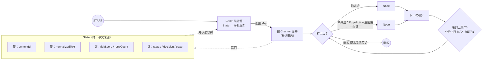
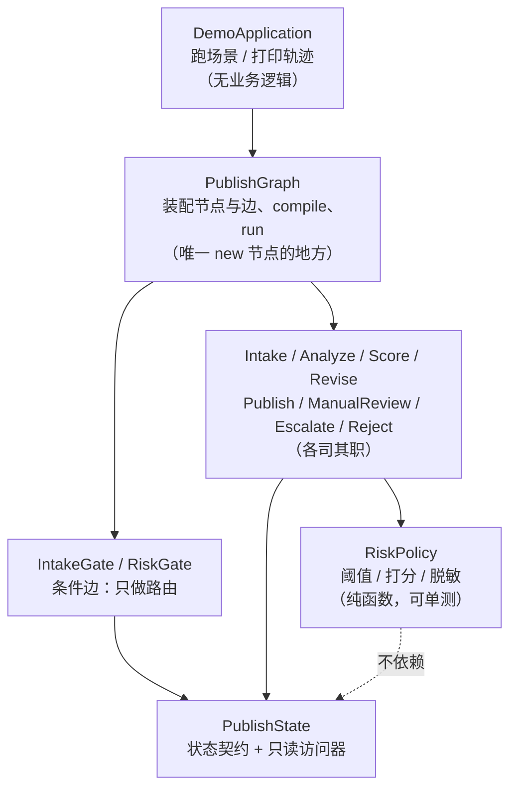
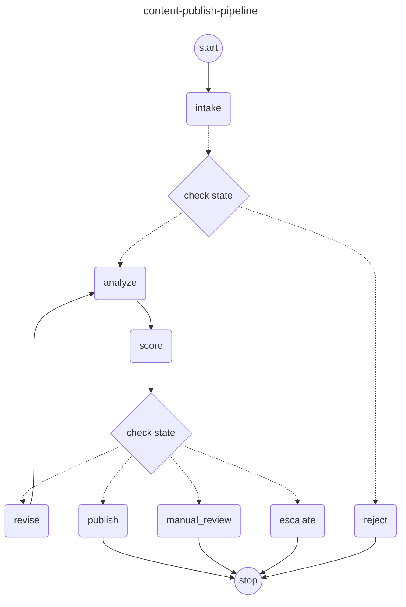
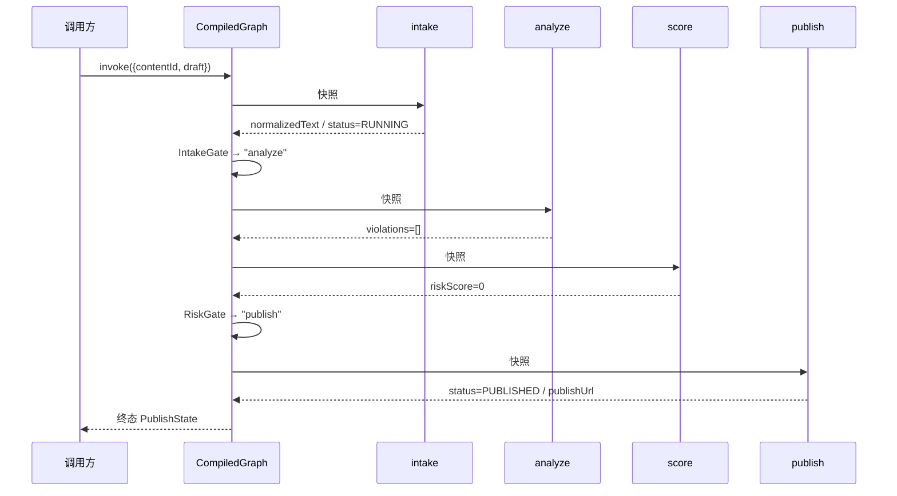
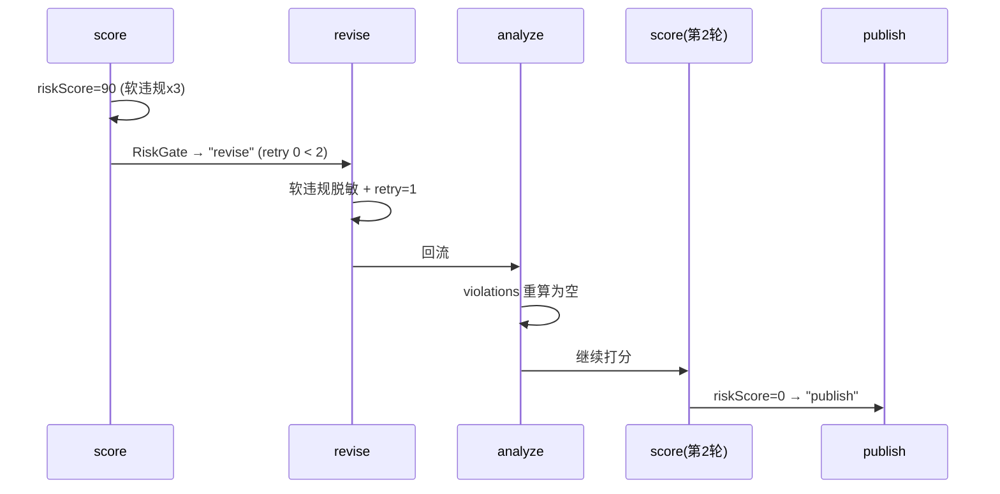
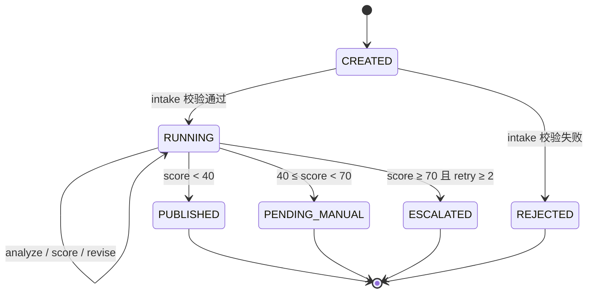

# Architecture.md —— 内容发布编排 Demo（LangGraph4j）

> **一句话结论**：这是一张"状态在节点间单向流动、由条件边决定分叉、用业务重试 + 框架递归上限双保险"的编排图，
> 覆盖 1 条线性主干、2 处条件门禁、1 条回流和 4 个终止态；5 个场景与 12 个单测全部通过
> （证据：`evidence/demo-run.log`、`evidence/mvn-test.log`）。

本文分两层讲架构：**第 1 部分是我对 LangGraph 执行模型的理解**（框架层，与具体业务无关），
**第 2 部分是这个 demo 如何把该模型落成代码**（应用层）。所有结论都标注了可定位的证据。

---

## 0. 怎么读这份文档

- 只想快速判断"做没做成"：读 §3.4 的场景轨迹 + §8 验收对照；
- 想核对"架构理解对不对"：读 §1（框架模型）与 §2（分层与拓扑图）；
- 想接手改代码：读 §4（状态契约）、§5（设计决策）与 §6（扩展点）。

---

## 1. 我理解的 LangGraph 架构（框架层）

### 1.1 三个基本抽象

LangGraph 把"后端编排"抽象成三样东西，其余（编译、检查点、中断）都是围绕它们的外围设施。

| 抽象 | 本质 | 在本 demo 中的体现 | 关键约束 |
| --- | --- | --- | --- |
| **State（状态）** | 节点之间传递的**唯一事实来源**，一个键值容器 | `PublishState`（`state/PublishState.java`） | 不可原地修改；节点只能返回"局部更新" |
| **Node（节点）** | 一个纯计算单元：`State -> 局部更新 Map` | 8 个节点类（`nodes/*.java`） | 单一职责；不做路由决策 |
| **Edge（边）** | 决定"下一个执行谁" | `START/END` 边 + 2 条条件边 | 静态边固定顺序；条件边只读状态返回路由键 |

补充两个容易被忽略但很关键的概念：

- **Channel（通道）**：每个状态键背后是一条通道，决定"多次写入如何合并"。默认是覆盖（后写胜），
  `AppenderChannel` 则是追加。本 demo 用默认覆盖通道，因此 `trace` 必须**显式返回新列表**
  （证据：`PublishState.java:87` 的 `traceAfter`）；
- **Compile（编译）**：`StateGraph` 只是"图纸"，`compile()` 才校验图是否合法（例如必须有 `START` 出边、
  节点不能连到 `START`）并产出可执行的 `CompiledGraph`（证据：`PublishGraph.java:80`）。

### 1.2 执行模型：超步 + 状态合并

框架采用 Pregel 风格的**超步（super-step）**执行：

1. 从 `START` 出发，找到当前被激活的节点；
2. 并行执行这些节点，每个节点拿到**当前状态的快照**，返回局部更新；
3. 框架按 channel 把局部更新**合并**成新状态；
4. 沿边计算下一批激活节点：静态边直接给出目标，条件边调用 `EdgeAction` 得到路由键再查映射表；
5. 重复 2-4，直到没有激活节点或到达 `END`。

两个直接后果，写代码时必须考虑：

- **节点看到的是快照**：同一超步内并行节点互相看不见对方的写入，所以有依赖关系的节点必须用边串起来（本 demo 的 `analyze → score` 就是这种依赖）；
- **必须有终止保证**：回流（循环）靠两道闸——业务上的 `MAX_RETRY = 2`（`RiskPolicy.java:31`）和框架的
  `recursionLimit`（默认 25，见 `CompileConfig` 的字段默认值）。只靠其中一道都不安全：只靠业务上限，图改错时会死循环；只靠框架上限，报错信息对业务无意义。

### 1.3 框架模型图

### 1.4 与传统 service 编排的差别

| 维度 | 传统写法（一堆 if/else + service 调用） | LangGraph 写法 |
| --- | --- | --- |
| 流程形态 | 隐含在方法调用栈里，读代码靠"跳转" | 显式图结构，一眼看到全部路径 |
| 新增一条分支 | 改主流程方法，回归面大 | 加一个节点 + 一条条件边，主干不动 |
| 状态传递 | 参数越传越长，或塞进 ThreadLocal | 收敛到 State 契约，节点只声明"我要读/写哪些键" |
| 可观测 | 靠日志拼流程 | State 里带 `trace`，路径可断言、可回放 |
| 可恢复 | 需要自己设计断点 | 接 checkpointer 即获得断点续跑（本 demo 未接，见 §7） |

---

## 2. 本 demo 的整体架构（应用层）

### 2.1 分层

**分层的判据是"依赖方向"**：上层依赖下层，下层不知道上层存在。
`RiskPolicy` 完全不认识图（`policy/RiskPolicy.java` 没有 import 任何 `org.bsc.langgraph4j` 类型），
所以改阈值、加违规词都不会碰编排代码。

### 2.2 模块职责表

| 模块 | 职责 | 关键文件 | 不该做的事 |
| --- | --- | --- | --- |
| 入口 | 跑场景、打印、可选输出拓扑图 | `DemoApplication.java:24`（场景表）、`:40`（`--diagram`） | 写业务判断 |
| 图装配 | 声明 8 个节点、7 条静态边、2 条条件边；`compile` / `run` / `mermaid` | `PublishGraph.java:44-77`、`:80`、`:85`、`:94` | 写节点内部逻辑 |
| 条件边 | 只读状态、返回路由键 | `IntakeGate.java:16`、`RiskGate.java:26-34` | 改状态、调外部服务 |
| 节点 | 单一职责的状态变换 | `nodes/*.java` | 互相 `new`、直接跳转 |
| 策略 | 阈值、打分、脱敏 | `RiskPolicy.java:27-31`（阈值）、`:61-90`（打分与脱敏） | 持久化、IO |
| 状态 | 键常量 + 只读访问器 + 轨迹工具 | `PublishState.java` | 承载业务逻辑 |

### 2.3 拓扑图（由代码生成，非手画）

下面这张图来自 `PublishGraph.mermaid()`（`PublishGraph.java:94`），运行
`mvn -q exec:java -Dexec.args=--diagram` 可重新生成，原始输出见 `evidence/mermaid.txt`：

**这张图说明什么**：主干是 `intake → analyze → score`；`score` 之后是唯一的分叉点（4 个出口）；
`revise → analyze` 是唯一的回边（因此唯一可能循环的地方）；`reject` 单独一条短路，避免非法输入进入风控。

---

## 3. 主流程：一次请求怎么走

### 3.1 正常路径（自动发布）

### 3.2 回流路径（自动改写后重判）

回流的落点是 `analyze` 而不是 `score`，这是刻意的：改写改变了文本，**违规明细和分数必须一起重算**，
否则会出现"文本已脱敏、violations 还留着旧命中"的不一致（证据：`PublishGraph.java:72` 的 `revise → analyze`）。

### 3.3 状态机视角

### 3.4 五个场景的真实轨迹

以下轨迹摘自 `evidence/demo-run.log`（`mvn -q exec:java` 的实际输出，非手写）：

| 场景 | 输入特征 | 轨迹 | 终态 | 关键数字 |
| --- | --- | --- | --- | --- |
| A 正常 | 无违规、长度足够 | `intake → analyze → score → publish` | `PUBLISHED` | score=0, retry=0 |
| B 轻度 | 软违规 ×2 | `intake → analyze → score → manual_review` | `PENDING_MANUAL` | score=60 |
| C 中度 | 软违规 ×3 | `intake → analyze → score → revise → analyze → score → publish` | `PUBLISHED` | score 90→0，retry=1 |
| D 重度 | 硬违规 ×2 | `intake → analyze → score → revise → analyze → score → revise → analyze → score → escalate` | `ESCALATED` | score=100，retry=2 |
| E 非法 | draft 为空 | `intake → reject` | `REJECTED` | 未进入风控 |

两个值得注意的点：C 证明**软违规可被自动修复**（回流一次即降为 0）；D 证明**硬违规不可自动修复**
（两轮改写后分数仍为 100，最终升级人工，而不是无限重试）。

---

## 4. 状态设计

| 状态键 | 类型 | 写入节点 | 语义 | 默认值 |
| --- | --- | --- | --- | --- |
| `contentId` | String | intake（trim 后） | 内容唯一标识，非法则拒绝 | `""` |
| `rawDraft` | String | 调用方（入参） | 原始草稿，全程只读 | `""` |
| `normalizedText` | String | intake / revise | 规范化 / 脱敏后的文本，打分只认它 | 回退到 `rawDraft` |
| `violations` | List&lt;String&gt; | analyze | 命中明细，`HARD:` / `SOFT:` 前缀 | 空列表 |
| `riskScore` | int | score | 0-100 风险分 | 0 |
| `retryCount` | int | revise | 自动改写次数，受控于 `MAX_RETRY` | 0 |
| `status` | String | 各节点 | 终态判别的主要字段 | `CREATED` |
| `decision` | String | 各节点 | 决策原因，便于审计 | `PENDING` |
| `publishUrl` | String | publish | 发布地址 | `""` |
| `validationError` | String | intake | 校验失败原因 | `""` |
| `trace` | List&lt;String&gt; | 所有节点 | 访问过的节点序列，用于断言与观测 | 空列表 |

**为什么用"空字符串"而不是 null 表示缺失**：`AgentState.value()` 返回 `Optional`，
但节点里到处 `orElse("")` 会让代码噪音很大；统一用哨兵值 + 只读访问器（`PublishState.java:60`），
调用方永远拿到非 null，判断语义用 `isBlank()`（如 `IntakeGate.java:16`）。

**为什么 `trace` 要显式拼新列表**：默认 channel 是覆盖语义，原地 `add` 不会进入下一轮状态，
这是 LangGraph 新手最常踩的坑（`PublishState.java:87` 的注释写明了这一点）。

---

## 5. 关键设计决策

| 编号 | 决策 | 理由 | 代价 |
| --- | --- | --- | --- |
| D1 | 校验失败**不抛异常**，落 `REJECTED` 终态 + 独立 reject 节点 | 异常会让图外调用方难以区分"业务拒绝"与"系统故障"；显式路径可审计、可测试 | 多一个节点、多一条边 |
| D2 | 把"分析"和"打分"拆成两个节点 | 评分规则会频繁调整，拆开后改 `RiskPolicy` 不影响分析；回流时两者都能重算 | 超步数 +1，性能略降 |
| D3 | 回流指向 `analyze` 而非 `score` | 保证 `violations` 与 `riskScore` 永远基于同一份文本 | 每轮回流多一次分析开销 |
| D4 | 区分软违规（可脱敏）与硬违规（不可脱敏） | 自动修复能力有边界，硬违规必须人工；否则会"改一改就放行" | 规则需要维护两套词表 |
| D5 | 阈值全部集中在 `RiskPolicy`（40 / 70 / 2） | 调阈值不动图；单测可直接断言常量（`RiskPolicyTest.java`） | 策略类承担了"配置中心"角色 |
| D6 | 循环双保险：`MAX_RETRY` + `recursionLimit` | 只靠业务上限，图改错会死循环；只靠框架上限，报错对业务无意义 | 需要理解两个上限的关系 |

---

## 6. 扩展点：这张图怎么长大

| 方向 | 做法 | 影响面 |
| --- | --- | --- |
| 断点续跑 | `compile(CompileConfig.builder().checkpointSaver(...).build())` | 只改 `PublishGraph.compile()`，节点不动 |
| 人工介入 | `interruptBefore("manual_review")` + `updateState` 回填结论 | 新增"人工结论"状态键 |
| 并行审核 | 把 analyze 拆成"词表命中 / 模型打分"两个节点并行，再汇聚 | 新增汇聚节点，`violations` 需要 `AppenderChannel` |
| 子图复用 | 把"内容审核"整张图作为子图嵌入更大的发布流程 | 主图只加一个节点 |
| 流式可观测 | `compiled.stream(inputs)` 逐步输出，前端实时展示进度 | 入口改成流式消费 |

---

## 7. 与生产级编排的差距（诚实清单）

1. **无持久化**：状态只在内存，进程重启即丢失——需要接 checkpointer（文件/Redis/Postgres）；
2. **无中断与恢复**：人工复核只是"落终态"，没有真正挂起等待人工回填；
3. **无并行**：所有节点串行执行，未利用超步的并行能力；
4. **策略是演示级**：词表硬编码、打分线性叠加，真实系统应接模型打分 + 规则引擎；
5. **无鉴权与幂等**：`contentId` 未做去重，重复提交会产生重复发布；
6. **无超时与熔断**：节点内没有外部调用，接入发布服务后必须补超时、重试与降级。

这些都写在 `docs/contract.md` 的"未覆盖"一节里，避免"看起来做完了"。

---

## 8. 验收对照

| 作业要求 | 完成情况 | 证据 |
| --- | --- | --- |
| 读懂 LangGraph 核心架构（State / Node / Edge / 编排怎么走） | 完成：§1 给出执行模型与超步语义 | 本文 §1，配套 `evidence/mermaid.txt` |
| 了解两个 skill（writing-skill / dev-skill） | 完成：两份 skill 文档落在仓库内 | `skills/writing-skill/SKILL.md`、`skills/dev-skill/SKILL.md` |
| 写出自己的 Architecture.md | 完成：本文即交付物，图由代码生成 | 本文 §2.3、§3 |
| 后端编排 demo（State + 多 Node 流转） | 完成：8 节点 / 2 条件边 / 1 回流 / 4 终态，可运行 | `mvn -q exec:java`，`evidence/demo-run.log` |
| 必须带开发文档（按 writing-skill：证据、结构、可核验） | 完成：`docs/dev-doc.md` 按该 skill 三条硬规则写 | `docs/dev-doc.md` §4 证据链、§5 复现步骤 |
| demo 可运行、附仓库/PR | 完成：本地仓库 + 交付分支 | 分支 `feat/xxkingzyy-langgraph-orchestration-demo` |
